<!-- Generated by scripts/docs/architecture.mjs from the code in src/. Do not edit by hand: run `npm run docs:architecture`. -->

# Architecture

This page is generated from the code, so it cannot go stale. It shows the structure only: which units exist, which import which, and what each feature exposes. Arrows point from the importing unit to the one it imports. A dashed arrow means every import between the two is lazy (`import()`). Stories are left out; stylesheet `@import`s count as imports, and so do type-only imports (`import type`), which cost nothing at runtime but still tie two units together. The rules the arrows must follow are in `.claude/CLAUDE.md`, and ESLint enforces them.

## Units

A unit is a folder: an app, a feature (or a concern folder of a feature that has them), a kind of shared code, a design-system layer, or the styles.

- **app**: `contribute`, `public-map`, `studio`
- **features**: `contribute`, `contribute/account`, `contribute/api`, `contribute/app-update`, `contribute/common`, `contribute/consent`, `contribute/history`, `contribute/map`, `contribute/native`, `contribute/native-bridge`, `contribute/recorder`, `contribute/screens`, `contribute/storage`, `contribute/tutorial`, `contribute/uploads`, `locator`, `published-map`, `routes/cards`, `routes/geo`, `routes/map`, `routes/model`, `routes/published`, `studio`, `studio/auth`, `studio/contributors`, `studio/data`, `studio/drawing`, `studio/maps`, `studio/panels`, `studio/public-view`, `studio/review`
- **shared**: `config`, `hooks`, `lib`, `types`, `ui`, `utils`
- **design-system**: `foundation`, `primitives`
- **styles**: `styles`

## Import graph

```mermaid
flowchart TD
  subgraph app_layer["app"]
    app_contribute["contribute"]
    app_public_map["public-map"]
    app_studio["studio"]
  end
  subgraph features_layer["features"]
    features_contribute["contribute"]
    features_contribute_account["contribute/account"]
    features_contribute_api["contribute/api"]
    features_contribute_app_update["contribute/app-update"]
    features_contribute_common["contribute/common"]
    features_contribute_consent["contribute/consent"]
    features_contribute_history["contribute/history"]
    features_contribute_map["contribute/map"]
    features_contribute_native["contribute/native"]
    features_contribute_native_bridge["contribute/native-bridge"]
    features_contribute_recorder["contribute/recorder"]
    features_contribute_screens["contribute/screens"]
    features_contribute_storage["contribute/storage"]
    features_contribute_tutorial["contribute/tutorial"]
    features_contribute_uploads["contribute/uploads"]
    features_locator["locator"]
    features_published_map["published-map"]
    features_routes_cards["routes/cards"]
    features_routes_geo["routes/geo"]
    features_routes_map["routes/map"]
    features_routes_model["routes/model"]
    features_routes_published["routes/published"]
    features_studio["studio"]
    features_studio_auth["studio/auth"]
    features_studio_contributors["studio/contributors"]
    features_studio_data["studio/data"]
    features_studio_drawing["studio/drawing"]
    features_studio_maps["studio/maps"]
    features_studio_panels["studio/panels"]
    features_studio_public_view["studio/public-view"]
    features_studio_review["studio/review"]
  end
  subgraph shared_layer["shared"]
    shared_config["config"]
    shared_hooks["hooks"]
    shared_lib["lib"]
    shared_types["types"]
    shared_ui["ui"]
    shared_utils["utils"]
  end
  subgraph design_system_layer["design-system"]
    design_system_foundation["foundation"]
    design_system_primitives["primitives"]
  end
  subgraph styles_layer["styles"]
    styles["styles"]
  end
  app_contribute --> design_system_foundation
  app_contribute --> features_contribute
  app_contribute --> features_locator
  app_contribute --> shared_lib
  app_contribute --> shared_ui
  app_contribute --> styles
  app_public_map --> features_locator
  app_public_map --> features_published_map
  app_public_map --> features_routes_cards
  app_public_map --> features_routes_map
  app_public_map --> features_routes_model
  app_public_map --> features_routes_published
  app_public_map --> shared_hooks
  app_public_map --> shared_utils
  app_public_map --> styles
  app_studio --> features_locator
  app_studio --> features_routes_cards
  app_studio --> features_routes_map
  app_studio --> features_routes_model
  app_studio --> features_studio
  app_studio --> shared_hooks
  app_studio --> shared_types
  app_studio --> styles
  features_contribute --> features_contribute_account
  features_contribute --> features_contribute_api
  features_contribute --> features_contribute_common
  features_contribute --> features_contribute_consent
  features_contribute --> features_contribute_history
  features_contribute --> features_contribute_map
  features_contribute -.-> features_contribute_native
  features_contribute --> features_contribute_native_bridge
  features_contribute --> features_contribute_recorder
  features_contribute --> features_contribute_screens
  features_contribute --> features_contribute_storage
  features_contribute --> features_contribute_uploads
  features_contribute_account --> design_system_primitives
  features_contribute_account --> features_contribute_api
  features_contribute_account --> features_contribute_common
  features_contribute_account --> features_contribute_screens
  features_contribute_account --> features_contribute_storage
  features_contribute_account --> features_contribute_uploads
  features_contribute_account --> shared_hooks
  features_contribute_account --> shared_ui
  features_contribute_account --> shared_utils
  features_contribute_api --> features_contribute_recorder
  features_contribute_api --> features_contribute_storage
  features_contribute_api --> features_routes_model
  features_contribute_api --> shared_types
  features_contribute_api --> shared_utils
  features_contribute_app_update --> design_system_primitives
  features_contribute_app_update --> features_contribute_api
  features_contribute_app_update --> features_contribute_native_bridge
  features_contribute_common --> design_system_primitives
  features_contribute_common --> features_contribute_native_bridge
  features_contribute_common --> shared_ui
  features_contribute_consent --> design_system_primitives
  features_contribute_consent --> features_contribute_api
  features_contribute_consent --> features_contribute_common
  features_contribute_consent --> features_contribute_storage
  features_contribute_history --> design_system_foundation
  features_contribute_history --> design_system_primitives
  features_contribute_history --> features_contribute_api
  features_contribute_history --> features_contribute_common
  features_contribute_history --> features_contribute_recorder
  features_contribute_history --> features_contribute_screens
  features_contribute_history --> features_contribute_storage
  features_contribute_history --> features_contribute_uploads
  features_contribute_history --> features_routes_map
  features_contribute_history --> features_routes_model
  features_contribute_history --> shared_hooks
  features_contribute_history --> shared_ui
  features_contribute_history --> shared_utils
  features_contribute_map --> design_system_foundation
  features_contribute_map --> design_system_primitives
  features_contribute_map --> features_contribute_common
  features_contribute_map --> features_contribute_recorder
  features_contribute_map --> features_contribute_storage
  features_contribute_map --> features_routes_map
  features_contribute_map --> features_routes_model
  features_contribute_map --> features_routes_published
  features_contribute_map --> shared_config
  features_contribute_map --> shared_hooks
  features_contribute_map --> shared_ui
  features_contribute_map --> shared_utils
  features_contribute_native --> design_system_primitives
  features_contribute_native --> features_contribute_common
  features_contribute_native --> features_contribute_native_bridge
  features_contribute_native --> features_contribute_recorder
  features_contribute_native --> features_contribute_screens
  features_contribute_native --> features_contribute_storage
  features_contribute_native --> shared_utils
  features_contribute_native_bridge --> features_contribute_app_update
  features_contribute_native_bridge -.-> features_contribute_native
  features_contribute_recorder --> features_contribute_consent
  features_contribute_recorder -.-> features_contribute_native
  features_contribute_recorder --> features_contribute_native_bridge
  features_contribute_recorder --> features_contribute_storage
  features_contribute_recorder --> features_routes_map
  features_contribute_recorder --> features_routes_model
  features_contribute_recorder --> shared_utils
  features_contribute_screens --> design_system_primitives
  features_contribute_screens -.-> features_contribute_app_update
  features_contribute_screens --> features_contribute_common
  features_contribute_screens --> features_contribute_consent
  features_contribute_screens --> features_contribute_map
  features_contribute_screens -.-> features_contribute_native
  features_contribute_screens --> features_contribute_recorder
  features_contribute_screens --> features_contribute_storage
  features_contribute_screens --> features_routes_cards
  features_contribute_screens --> shared_hooks
  features_contribute_screens --> shared_ui
  features_contribute_screens --> shared_utils
  features_contribute_storage --> features_routes_model
  features_contribute_tutorial --> design_system_primitives
  features_contribute_uploads --> features_contribute_api
  features_contribute_uploads --> features_contribute_consent
  features_contribute_uploads --> features_contribute_recorder
  features_contribute_uploads --> features_contribute_storage
  features_contribute_uploads --> shared_ui
  features_locator --> features_routes_map
  features_locator --> features_routes_model
  features_locator --> shared_hooks
  features_locator --> shared_ui
  features_locator --> shared_utils
  features_published_map --> design_system_primitives
  features_published_map --> features_routes_map
  features_published_map --> features_routes_published
  features_published_map --> shared_utils
  features_routes_cards --> design_system_primitives
  features_routes_cards --> features_routes_model
  features_routes_cards --> shared_ui
  features_routes_cards --> shared_utils
  features_routes_geo --> shared_utils
  features_routes_map --> design_system_foundation
  features_routes_map --> design_system_primitives
  features_routes_map --> features_routes_cards
  features_routes_map --> features_routes_geo
  features_routes_map --> features_routes_model
  features_routes_map --> shared_config
  features_routes_map --> shared_ui
  features_routes_map --> shared_utils
  features_routes_model --> features_routes_geo
  features_routes_model --> shared_utils
  features_routes_published --> features_routes_model
  features_studio --> features_studio_auth
  features_studio --> features_studio_contributors
  features_studio --> features_studio_data
  features_studio --> features_studio_drawing
  features_studio --> features_studio_maps
  features_studio --> features_studio_panels
  features_studio --> features_studio_public_view
  features_studio --> features_studio_review
  features_studio_auth --> design_system_primitives
  features_studio_auth --> features_routes_map
  features_studio_auth --> features_studio_data
  features_studio_auth --> shared_lib
  features_studio_auth --> shared_ui
  features_studio_contributors --> design_system_foundation
  features_studio_contributors --> design_system_primitives
  features_studio_contributors --> features_studio_data
  features_studio_contributors --> features_studio_drawing
  features_studio_contributors --> shared_utils
  features_studio_data --> features_routes_geo
  features_studio_data --> features_routes_model
  features_studio_data --> features_routes_published
  features_studio_data --> shared_types
  features_studio_data --> shared_utils
  features_studio_drawing --> design_system_foundation
  features_studio_drawing --> features_routes_map
  features_studio_drawing --> features_routes_model
  features_studio_drawing --> features_studio_data
  features_studio_drawing --> shared_utils
  features_studio_maps --> design_system_foundation
  features_studio_maps --> design_system_primitives
  features_studio_maps --> features_routes_map
  features_studio_maps --> features_studio_data
  features_studio_panels --> design_system_primitives
  features_studio_panels --> features_routes_cards
  features_studio_panels --> features_routes_geo
  features_studio_panels --> features_routes_map
  features_studio_panels --> features_routes_model
  features_studio_panels --> features_studio_data
  features_studio_panels --> features_studio_drawing
  features_studio_panels --> features_studio_review
  features_studio_panels --> shared_ui
  features_studio_panels --> shared_utils
  features_studio_public_view --> design_system_primitives
  features_studio_public_view --> features_studio_data
  features_studio_public_view --> features_studio_maps
  features_studio_review --> design_system_primitives
  features_studio_review --> features_studio_auth
  features_studio_review --> features_studio_data
  features_studio_review --> features_studio_maps
  shared_ui --> design_system_primitives
  shared_ui --> shared_hooks
  styles --> design_system_foundation
```

### What each unit imports

| Unit | Imports |
| --- | --- |
| `app/contribute` | `design-system/foundation`, `features/contribute`, `features/locator`, `shared/lib`, `shared/ui`, `styles` |
| `app/public-map` | `features/locator`, `features/published-map`, `features/routes/cards`, `features/routes/map`, `features/routes/model`, `features/routes/published`, `shared/hooks`, `shared/utils`, `styles` |
| `app/studio` | `features/locator`, `features/routes/cards`, `features/routes/map`, `features/routes/model`, `features/studio`, `shared/hooks`, `shared/types`, `styles` |
| `design-system/foundation` | — |
| `design-system/primitives` | — |
| `features/contribute` | `features/contribute/account`, `features/contribute/api`, `features/contribute/common`, `features/contribute/consent`, `features/contribute/history`, `features/contribute/map`, `features/contribute/native`, `features/contribute/native-bridge`, `features/contribute/recorder`, `features/contribute/screens`, `features/contribute/storage`, `features/contribute/uploads` |
| `features/contribute/account` | `design-system/primitives`, `features/contribute/api`, `features/contribute/common`, `features/contribute/screens`, `features/contribute/storage`, `features/contribute/uploads`, `shared/hooks`, `shared/ui`, `shared/utils` |
| `features/contribute/api` | `features/contribute/recorder`, `features/contribute/storage`, `features/routes/model`, `shared/types`, `shared/utils` |
| `features/contribute/app-update` | `design-system/primitives`, `features/contribute/api`, `features/contribute/native-bridge` |
| `features/contribute/common` | `design-system/primitives`, `features/contribute/native-bridge`, `shared/ui` |
| `features/contribute/consent` | `design-system/primitives`, `features/contribute/api`, `features/contribute/common`, `features/contribute/storage` |
| `features/contribute/history` | `design-system/foundation`, `design-system/primitives`, `features/contribute/api`, `features/contribute/common`, `features/contribute/recorder`, `features/contribute/screens`, `features/contribute/storage`, `features/contribute/uploads`, `features/routes/map`, `features/routes/model`, `shared/hooks`, `shared/ui`, `shared/utils` |
| `features/contribute/map` | `design-system/foundation`, `design-system/primitives`, `features/contribute/common`, `features/contribute/recorder`, `features/contribute/storage`, `features/routes/map`, `features/routes/model`, `features/routes/published`, `shared/config`, `shared/hooks`, `shared/ui`, `shared/utils` |
| `features/contribute/native` | `design-system/primitives`, `features/contribute/common`, `features/contribute/native-bridge`, `features/contribute/recorder`, `features/contribute/screens`, `features/contribute/storage`, `shared/utils` |
| `features/contribute/native-bridge` | `features/contribute/app-update`, `features/contribute/native` |
| `features/contribute/recorder` | `features/contribute/consent`, `features/contribute/native`, `features/contribute/native-bridge`, `features/contribute/storage`, `features/routes/map`, `features/routes/model`, `shared/utils` |
| `features/contribute/screens` | `design-system/primitives`, `features/contribute/app-update`, `features/contribute/common`, `features/contribute/consent`, `features/contribute/map`, `features/contribute/native`, `features/contribute/recorder`, `features/contribute/storage`, `features/routes/cards`, `shared/hooks`, `shared/ui`, `shared/utils` |
| `features/contribute/storage` | `features/routes/model` |
| `features/contribute/tutorial` | `design-system/primitives` |
| `features/contribute/uploads` | `features/contribute/api`, `features/contribute/consent`, `features/contribute/recorder`, `features/contribute/storage`, `shared/ui` |
| `features/locator` | `features/routes/map`, `features/routes/model`, `shared/hooks`, `shared/ui`, `shared/utils` |
| `features/published-map` | `design-system/primitives`, `features/routes/map`, `features/routes/published`, `shared/utils` |
| `features/routes/cards` | `design-system/primitives`, `features/routes/model`, `shared/ui`, `shared/utils` |
| `features/routes/geo` | `shared/utils` |
| `features/routes/map` | `design-system/foundation`, `design-system/primitives`, `features/routes/cards`, `features/routes/geo`, `features/routes/model`, `shared/config`, `shared/ui`, `shared/utils` |
| `features/routes/model` | `features/routes/geo`, `shared/utils` |
| `features/routes/published` | `features/routes/model` |
| `features/studio` | `features/studio/auth`, `features/studio/contributors`, `features/studio/data`, `features/studio/drawing`, `features/studio/maps`, `features/studio/panels`, `features/studio/public-view`, `features/studio/review` |
| `features/studio/auth` | `design-system/primitives`, `features/routes/map`, `features/studio/data`, `shared/lib`, `shared/ui` |
| `features/studio/contributors` | `design-system/foundation`, `design-system/primitives`, `features/studio/data`, `features/studio/drawing`, `shared/utils` |
| `features/studio/data` | `features/routes/geo`, `features/routes/model`, `features/routes/published`, `shared/types`, `shared/utils` |
| `features/studio/drawing` | `design-system/foundation`, `features/routes/map`, `features/routes/model`, `features/studio/data`, `shared/utils` |
| `features/studio/maps` | `design-system/foundation`, `design-system/primitives`, `features/routes/map`, `features/studio/data` |
| `features/studio/panels` | `design-system/primitives`, `features/routes/cards`, `features/routes/geo`, `features/routes/map`, `features/routes/model`, `features/studio/data`, `features/studio/drawing`, `features/studio/review`, `shared/ui`, `shared/utils` |
| `features/studio/public-view` | `design-system/primitives`, `features/studio/data`, `features/studio/maps` |
| `features/studio/review` | `design-system/primitives`, `features/studio/auth`, `features/studio/data`, `features/studio/maps` |
| `shared/config` | — |
| `shared/hooks` | — |
| `shared/lib` | — |
| `shared/types` | — |
| `shared/ui` | `design-system/primitives`, `shared/hooks` |
| `shared/utils` | — |
| `styles` | `design-system/foundation` |

## Public APIs

A feature's `index.ts` is the only door into it for code outside the feature. What each one exports:

### `features/contribute`

`ContributePage`, `PageErrorScreen`, `ContributeLocatorSlot`, `connectContributions`, `hasOpenRecording`, `askForPersistentStorage`, `isNativeApp`, `prepareNativeApp`, `runEmulatorRide`

### `features/locator`

`useGazeHush`, `CommuterLocation`, `ContributorLocation`

### `features/published-map`

`listenForInstallOffer`, `InstallPrompt`, `loadProblems`, `Notices`, `registerServiceWorker`, `reloadForNewerApp`, `reloadToUpdate`, `useNeedRefresh`, `useMapAge`, `useOffline`, `useInstallPrompt`

### `features/studio`

`AuthDialogs`, `NotEditor`, `SignIn`, `skipSignInForTests`, `useAuthFlow`, `usePasswordRecovery`, `StudioSessionProvider`, `useEditorSession`, `loadHotspotsFromSupabase`, `lineOf`, `listDirections`, `getSupabase`, `setSupabase`, `supabaseConfig`, `supabaseConfigError`, `DrawToolbar`, `STUDIO_BASEMAPS`, `STUDIO_BASEMAP_THUMBNAILS`, `useDrawing`, `useFollow`, `useLoopClosing`, `MapPlaceholder`, `MapSwitch`, `useStudioMap`, `AccountPill`, `NEW_MENU_DOCK_FOOT`, `NewMenu`, `returnTripLeft`, `SaveToasts`, `StudioHotspotCard`, `StudioSaveSheets`, `StudioTripCard`, `useDeleteActions`, `useSaveFlow`, `useSaveTarget`, `useStudioTrip`, `StudioReview`, `StudioPublicView`, `StudioContributors`, `ContributionHint`, `useContributionStart`, `ContributionStart`, `CONTRIBUTIONS`

## Entry points

| Page | Loads |
| --- | --- |
| `index.html` | `src/app/public-map/main.tsx` |
| `studio/index.html` | `src/app/studio/main.tsx` |
