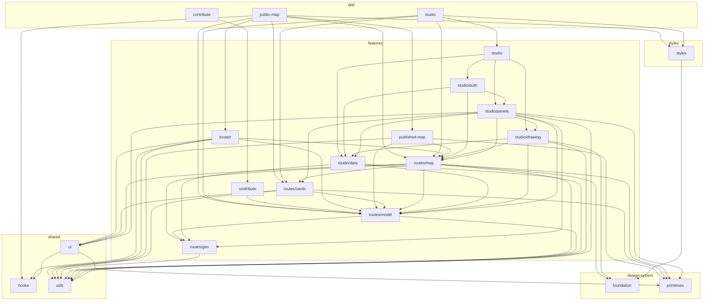

<!-- Generated by scripts/docs/architecture.mjs from the code in src/. Do not edit by hand: run `npm run docs:architecture`. -->

# Architecture

This page is generated from the code, so it cannot go stale. It shows the structure only: which units exist, which import which, and what each feature exposes. Arrows point from the importing unit to the one it imports. A dashed arrow means every import between the two is lazy (`import()`). Stories are left out; stylesheet `@import`s count as imports, and so do type-only imports (`import type`), which cost nothing at runtime but still tie two units together. The rules the arrows must follow are in `.claude/CLAUDE.md`, and ESLint enforces them.

## Units

A unit is a folder: an app, a feature (or a concern folder of a feature that has them), a kind of shared code, a design-system layer, or the styles.

- **app**: `contribute`, `public-map`, `studio`
- **features**: `contribute`, `locator`, `published-map`, `routes/cards`, `routes/geo`, `routes/map`, `routes/model`, `studio`, `studio/auth`, `studio/data`, `studio/drawing`, `studio/panels`
- **shared**: `hooks`, `ui`, `utils`
- **design-system**: `foundation`, `primitives`
- **styles**: `styles`

## Import graph

### What each unit imports

| Unit | Imports |
| --- | --- |
| `app/contribute` | `features/contribute` |
| `app/public-map` | `features/locator`, `features/published-map`, `features/routes/cards`, `features/routes/map`, `features/routes/model`, `shared/hooks`, `styles` |
| `app/studio` | `features/routes/cards`, `features/routes/map`, `features/routes/model`, `features/studio`, `styles` |
| `design-system/foundation` | — |
| `design-system/primitives` | — |
| `features/contribute` | `features/routes/model` |
| `features/locator` | `features/routes/map`, `features/routes/model`, `shared/hooks`, `shared/ui`, `shared/utils` |
| `features/published-map` | `design-system/primitives`, `features/routes/map`, `features/routes/model`, `shared/utils` |
| `features/routes/cards` | `design-system/primitives`, `features/routes/model`, `shared/ui`, `shared/utils` |
| `features/routes/geo` | `shared/utils` |
| `features/routes/map` | `design-system/foundation`, `design-system/primitives`, `features/routes/cards`, `features/routes/geo`, `features/routes/model`, `shared/ui`, `shared/utils` |
| `features/routes/model` | `features/routes/geo`, `shared/utils` |
| `features/studio` | `features/studio/auth`, `features/studio/data`, `features/studio/drawing`, `features/studio/panels` |
| `features/studio/auth` | `features/routes/map`, `features/studio/data`, `features/studio/panels` |
| `features/studio/data` | `features/routes/geo`, `features/routes/model`, `shared/utils` |
| `features/studio/drawing` | `design-system/foundation`, `features/routes/map`, `features/routes/model`, `features/studio/data`, `shared/utils` |
| `features/studio/panels` | `design-system/primitives`, `features/routes/cards`, `features/routes/geo`, `features/routes/map`, `features/routes/model`, `features/studio/data`, `features/studio/drawing`, `shared/ui`, `shared/utils` |
| `shared/hooks` | — |
| `shared/ui` | `design-system/primitives`, `shared/hooks` |
| `shared/utils` | — |
| `styles` | `design-system/foundation` |

## Public APIs

A feature's `index.ts` is the only door into it for code outside the feature. What each one exports:

### `features/contribute`

`ContributePage`

### `features/locator`

`useGazeHush`, `CommuterLocation`

### `features/published-map`

`fetchIndex`, `loadDirectionsFromFile`, `loadHotspotsFromFile`, `openingDirections`, `fetchLine`, `listenForInstallOffer`, `InstallPrompt`, `loadProblems`, `Notices`, `registerServiceWorker`, `reloadForNewerApp`, `reloadToUpdate`, `useNeedRefresh`, `useMapAge`, `useOffline`, `useInstallPrompt`

### `features/studio`

`AuthDialogs`, `SignIn`, `skipSignInForTests`, `useAuthFlow`, `usePasswordRecovery`, `useSession`, `lineOf`, `listDirections`, `loadHotspotsFromSupabase`, `getSupabase`, `setSupabase`, `supabaseConfig`, `supabaseConfigError`, `DrawToolbar`, `STUDIO_BASEMAPS`, `STUDIO_BASEMAP_THUMBNAILS`, `useDrawing`, `useFollow`, `AccountPill`, `NewButtons`, `returnTripLeft`, `SaveToasts`, `StudioHotspotCard`, `StudioSaveSheets`, `StudioTripCard`, `useDeleteActions`, `useSaveFlow`, `useSaveTarget`, `useStudioTrip`

## Entry points

| Page | Loads |
| --- | --- |
| `index.html` | `src/app/public-map/main.tsx` |
| `studio/index.html` | `src/app/studio/main.tsx` |
